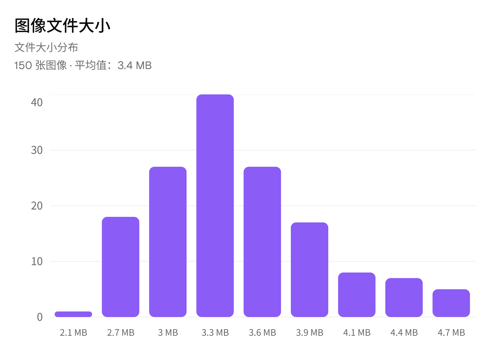
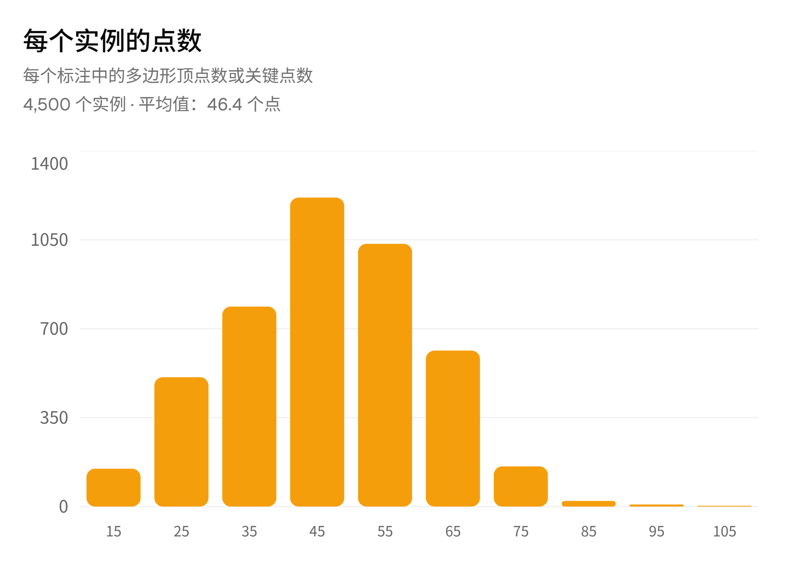

# 更新日志

2026.10.24：创建图像分割项目

# 一、项目背景

面向葡萄果粒密集分布、相互遮挡和小目标场景的实例分割任务，基于 YOLO11s-seg 在 Grapes 数据集上完成模型微调，并探索结构化剪枝与特征蒸馏对精度、模型大小和推理延迟的影响，找到符合要求的模型。

| 依赖库 | 版本 | 
| --- | --- |
| Python | 3.10.22 |
| PyTorch | 2.11.0+cu128 |
| LabelMe | 6.3.1 |
| Ultralytics | 8.4.208 |
| Torch-Pruning | 1.6.1 |
| Opencv-python | 5.0.0.93 |
| numpy | 2.2.6 |
| OpenCV(opencv-python) | 5.0.0.93 |
| onnx | 1.23.2 |
| ONNX Runtime | 1.23.2 |

计算资源：（CPU）Intel Core i9-14900HX；（GPU）RTX 4060 Laptop GPU

# 二、项目内容
## 2.1 数据集
<table>
  <thead>
    <tr>
      <th rowspan="2">名称</th>
      <th rowspan="2">类别</th>
      <th colspan="3">划分</th>
      <th rowspan="2">链接</th>
    </tr>
    <tr>
      <th>训练集</th>
      <th>验证集</th>
      <th>测试集</th>
    </tr>
  </thead>
  <tbody>
    <tr>
      <td rowspan="3">Grapes</td>
      <td>巨峰（Kyoho）</td>
      <td rowspan="3">100</td>
      <td rowspan="3">25</td>
      <td rowspan="3">25</td>
      <td rowspan="3"><a href="https://tianchi.aliyun.com/dataset/230037">点击下载</a></td>
    </tr>
    <tr>
      <td>阳光玫瑰（ShineMuscat）</td>
    </tr>
    <tr>
      <td>夏黑（SummerBlack）</td>
    </tr>
  </tbody>
</table>

**图表（划分分布、主要类别、图像尺寸、图像文件大小、图像格式、每张图像中的对象数、每个实例的点数）**

<details>
<summary>Grapes 数据集图表（点击展开，共 7 张）</summary>








</details>

## 2.2 实验方案
### 2.2.1 模型优化
| 序号 | 实验名称 | 实验目的 | 实验方法 | 配置 | 备注 |
| --- | --- | --- | --- | --- | --- |
| 01 | Baseline | 确立基线 | 基于 yolo11s-seg 预训练模型在 Grapes 数据集上完成全量微调 |  [arg.yaml](assets/exps/Grapes/runs/exp-01/arg.yaml) | --- |
| 02 | yolo11s-seg-HT | 判断调优后是否超越基线 | 在 Baseline 基础上使用遗传算法完成自动超参数调优 | --- | 由于计算资源限制，暂时跳过该实验 |
| 03 | yolo11s-seg-SP10 | 压缩模型大小并测量剪枝造成的即时损伤 | 在 yolo11s-seg 基础上完成模型 10% 通道剪枝 | [arg.yaml](assets/exps/Grapes/runs/exp-03/arg.yaml) | --- |
| 04 | yolo11s-seg-SP20 | 压缩模型大小并测量剪枝造成的即时损伤 | 在 yolo11s-seg 基础上完成模型 20% 通道剪枝 | [arg.yaml](assets/exps/Grapes/runs/exp-04/arg.yaml) | --- |
| 05 | yolo11s-seg-SP30 | 压缩模型大小并测量剪枝造成的即时损伤 | 在 yolo11s-seg 基础上完成模型 30% 通道剪枝 | [arg.yaml](assets/exps/Grapes/runs/exp-05/arg.yaml) | --- |
| 06 | yolo11s-seg-SP40 | 压缩模型大小并测量剪枝造成的即时损伤 | 在 yolo11s-seg 基础上完成模型 40% 通道剪枝 | [arg.yaml](assets/exps/Grapes/runs/exp-06/arg.yaml) | --- |
| 07 | yolo11s-seg-SP50 | 压缩模型大小并测量剪枝造成的即时损伤 | 在 yolo11s-seg 基础上完成模型 50% 通道剪枝 | [arg.yaml](assets/exps/Grapes/runs/exp-07/arg.yaml) | --- |
| 08 | yolo11s-seg-SP50-FT | 测量继续全量微调训练能够恢复多少 | 在 yolo11s-seg-SP50 基础上完成模型全量微调 | [arg.yaml](assets/exps/Grapes/runs/exp-08/arg.yaml) | --- |
| 09 | yolo11s-seg-SP50-KD | 判断教师监督是否带来额外收益 | 以 yolo11s-seg-SP50 为学生，Baseline 为教师，完成模型特征蒸馏 | [arg.yaml](assets/exps/Grapes/runs/exp-09/arg.yaml) | --- |
| 10 | yolo11n-seg-KD | 测量 yolo11n-seg 作为学生模型收益 | 以 yolo11n-seg 为学生，Baseline 为教师，完成模型特征蒸馏 | [arg.yaml](assets/exps/Grapes/runs/exp-10/arg.yaml) | --- |
| 11 | yolo11s-seg-SP50-KD-HHT | 提高模型精度 | 在 yolo11s-seg-SP50-KD 基础上，基于结果分析和人工先验知识完成超参数调优 | [arg.yaml](assets/exps/Grapes/runs/exp-11/arg.yaml) | --- |
| 12 | yolo11n-seg-KD-HHT | 提高模型精度 | 在 yolo11n-seg-KD 基础上，基于结果分析和人工先验知识完成超参数调优 | [arg.yaml](assets/exps/Grapes/runs/exp-12/arg.yaml) | --- |

## 2.3 实验结果
### 2.3.1 性能指标
*注：Speed CPU ONNX计算方式：（CPU）Intel Core i9-14900HX*
#### 总表
| 序号 | 实验名称 | Size（pixels） | Box mAP50-95（%） | Mask mAP50-95（%） | Speed CPU ONNX（ms） | Params（M） | FLOPs（B） | 配置 | 备注 |
| --- | --- | --- | --- | --- | --- | --- | --- | --- | --- |
| 01 | Baseline | 640 | 92.41 | 92.21 | 3582.8 ± 708.6 | 10.08 | 33.20 |  [arg.yaml](assets/exps/Grapes/runs/exp-01/arg.yaml) | --- |
| 02 | yolo11s-seg-HT | --- | --- | --- | --- | --- | --- | --- | 由于计算资源限制，暂时跳过该实验 |
| 03 | yolo11s-seg-SP10 | 640 | 84.66 | 82.50 | --- | 9.72 | 32.66 | [arg.yaml](assets/exps/Grapes/runs/exp-03/arg.yaml) | --- |
| 04 | yolo11s-seg-SP20 | 640 | 63.85 | 56.15 | --- | 9.36 | 32.09 | [arg.yaml](assets/exps/Grapes/runs/exp-04/arg.yaml) | --- |
| 05 | yolo11s-seg-SP30 | 640 | 43.38 | 37.80 | --- | 9.02 | 31.56 | [arg.yaml](assets/exps/Grapes/runs/exp-05/arg.yaml) | --- |
| 06 | yolo11s-seg-SP40 | 640 | 6.40 | 5.97 | --- | 8.71 | 31.06 | [arg.yaml](assets/exps/Grapes/runs/exp-06/arg.yaml) | --- |
| 07 | yolo11s-seg-SP50 | 640 | 2.47 | 2.58 | --- | 8.42 | 30.53 | [arg.yaml](assets/exps/Grapes/runs/exp-07/arg.yaml) | --- |
| 08 | yolo11s-seg-SP50-FT | 640 | 91.34 | 91.21 | 3102.2 ± 613.7 | 8.42 | 30.53 | [arg.yaml](assets/exps/Grapes/runs/exp-08/arg.yaml) | --- |
| 09 | yolo11s-seg-SP50-KD | 640 | 91.73 | 91.48 | 3033.2 ± 636.0 | 8.42 | 30.53 | [arg.yaml](assets/exps/Grapes/runs/exp-09/arg.yaml) | --- |
| 10 | yolo11n-seg-KD | 640 | 89.82 | 89.92 | 1531.4 ± 371.3 | 2.86 | 9.86 | [arg.yaml](assets/exps/Grapes/runs/exp-10/arg.yaml) | --- |
| 11 | yolo11s-seg-SP50-KD-HHT | 640 | --- | --- | --- | --- | --- | [arg.yaml](assets/exps/Grapes/runs/exp-11/arg.yaml) | --- |
| 12 | yolo11n-seg-KD-HHT | 640 | --- | --- | --- | --- | --- | [arg.yaml](assets/exps/Grapes/runs/exp-12/arg.yaml) | --- |

### 2.3.2 可视化结果

# 三、项目结构

## 3.1 目录结构
```text
image-seg/
├── assets/                      # 资产层
│   ├── data/                    # 数据
│   └── locals/                  # 本地训练权重（自己）
├── configs/                     # 配置层
│   ├── data-processeds/         # 数据预处理配置
│   ├── trains/                  # 模型训练配置
│   └── inferences/              # 模型推理配置
├── data/                        # 数据层
│   ├── raw/                     # 原始数据
│       └── 数据集名称/          
│           ├── 数据集详情.md
│           ├── train/
│           ├── val/ 
│           └── test/
│   └── processed/               # 预处理数据
│       └── 数据集名称/          
│           ├── 预处理数据集详情.md
│           ├── train/
│           ├── val/ 
│           └── test/
├── src/                         # 逻辑层
│   ├── data/                    # 数据预处理逻辑
│       ├── .py  
│       ├── evals.py  
│       └── models.py
│   ├── evals/                   # 评估指标逻辑
│       └── seg-common_eval.py
│   ├── inferences/              # 模型推理逻辑
│   ├── models/                  # 模型结构逻辑
│       └── 模型名称/          
│           ├── 模型结构详情.md   
│           └── 模型名称.py
│   ├── schemas/                 # 定义数据格式
│       ├── datasets.py  
│       ├── evals.py  
│       └── models.py
│   └── trains/                  # 模型训练逻辑
│       ├── double-stages_train.py
│       ├── few-sample_train.py  
│       └── zero-sample_train.py
├── results/                     # 实验结果层
│   └── 实验名称-时间戳/          
│       ├── 实验详情.md          
│       └── 实验名称-时间戳.log
├── scripts/                     # 执行层
│   ├── train.py
│   ├── inference.py
│   └── data_processed.py
└── requirements.txt             # 依赖库安装清单
```

## 3.2 文件索引
