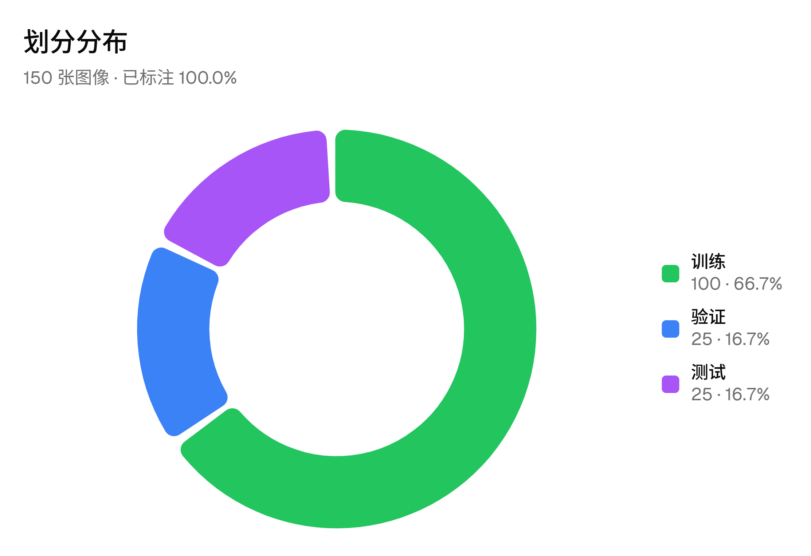
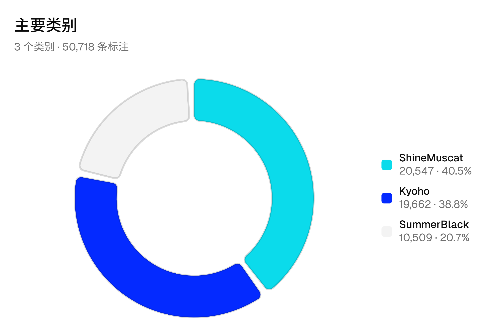
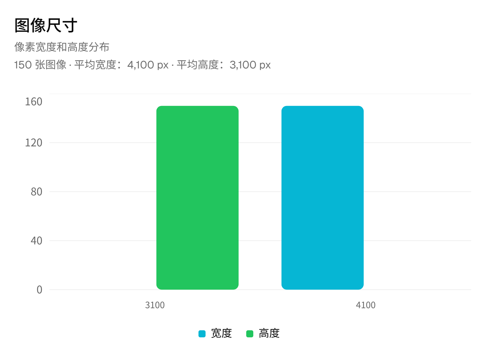
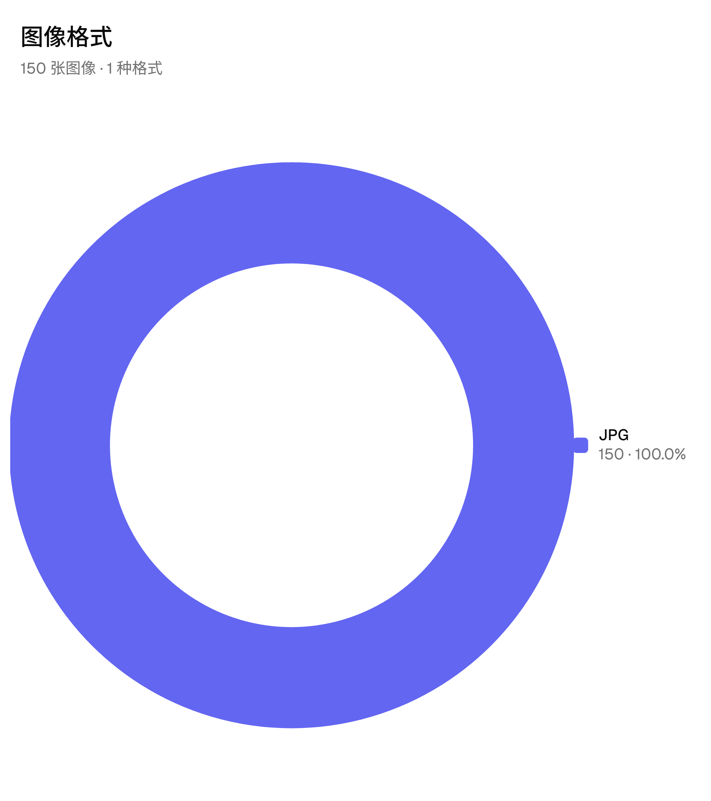
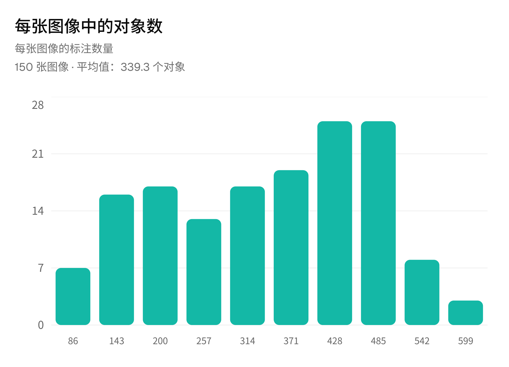

# 更新日志

2026.10.24：创建图像分割项目

# 一、项目背景

基于 YOLO11 的葡萄果粒实例分割与模型压缩：面向葡萄果粒密集分布、相互遮挡和小目标场景，基于 YOLO11s-seg 完成实例分割微调，并探索结构化剪枝与特征蒸馏对精度、模型规模和推理延迟的影响。

技术栈：Python、PyTorch、Ultralytics、Torch-Pruning、OpenCV；CPU 推理测试使用 ONNX Runtime。

# 二、项目内容
## 2.1 数据集
<table>
  <thead>
    <tr>
      <th rowspan="2">名称</th>
      <th rowspan="2">类别</th>
      <th colspan="3">划分</th>
      <th rowspan="2">链接</th>
    </tr>
    <tr>
      <th>训练集</th>
      <th>验证集</th>
      <th>测试集</th>
    </tr>
  </thead>
  <tbody>
    <tr>
      <td rowspan="3">Grapes</td>
      <td>巨峰（Kyoho）</td>
      <td rowspan="3">100</td>
      <td rowspan="3">25</td>
      <td rowspan="3">25</td>
      <td rowspan="3"><a href="https://tianchi.aliyun.com/dataset/230037">点击下载</a></td>
    </tr>
    <tr>
      <td>阳光玫瑰（ShineMuscat）</td>
    </tr>
    <tr>
      <td>夏黑（SummerBlack）</td>
    </tr>
    <tr>
      <td rowspan="3">--</td>
      <td>--</td>
      <td rowspan="3">--</td>
      <td rowspan="3">--</td>
      <td rowspan="3">--</td>
      <td rowspan="3"><a href="#">点击下载</a></td>
    </tr>
    <tr>
      <td>--</td>
    </tr>
  </tbody>
</table>

### 图表（划分分布、主要类别、图像尺寸、图像文件大小、图像格式、每张图像中的对象数、每个实例的点数）

<details>
<summary>Grapes 数据集图表（点击展开，共 7 张）</summary>



*图 1：划分分布。*



*图 2：主要类别。*



*图 3：图像尺寸。*


*图 4：图像文件大小。*



*图 5：图像格式。*



*图 6：每张图像中的对象数。*


*图 7：每个实例的点数。*

</details>

<details>
<summary>-- 数据集图表（点击展开，共 -- 张）</summary>


*图 1：--*

</details>

## 2.2 实验方案

## 2.3 实验结果

# 三、项目结构

```text
image-seg/
├── checkpoints/                 # 模型权重层
│   ├── downloads/               # 下载预训练权重（别人）
│   └── locals/                  # 本地训练权重（自己）
├── configs/                     # 配置层
│   ├── data-processeds/         # 数据预处理配置
│   ├── trains/                  # 模型训练配置
│   └── inferences/              # 模型推理配置
├── data/                        # 数据层
│   ├── raw/                     # 原始数据
│       └── 数据集名称/          
│           ├── 数据集详情.md
│           ├── train/
│           ├── val/ 
│           └── test/
│   └── processed/               # 预处理数据
│       └── 数据集名称/          
│           ├── 预处理数据集详情.md
│           ├── train/
│           ├── val/ 
│           └── test/
├── src/                         # 逻辑层
│   ├── data/                    # 数据预处理逻辑
│       ├── .py  
│       ├── evals.py  
│       └── models.py
│   ├── evals/                   # 评估指标逻辑
│       └── seg-common_eval.py
│   ├── inferences/              # 模型推理逻辑
│   ├── models/                  # 模型结构逻辑
│       └── 模型名称/          
│           ├── 模型结构详情.md   
│           └── 模型名称.py
│   ├── schemas/                 # 定义数据格式
│       ├── datasets.py  
│       ├── evals.py  
│       └── models.py
│   └── trains/                  # 模型训练逻辑
│       ├── double-stages_train.py
│       ├── few-sample_train.py  
│       └── zero-sample_train.py
├── results/                     # 实验结果层
│   └── 实验名称-时间戳/          
│       ├── 实验详情.md          
│       └── 实验名称-时间戳.log
├── scripts/                     # 执行层
│   ├── train.py
│   ├── inference.py
│   └── data_processed.py
└── requirements.txt             # 依赖库安装清单
```

# 四、文件索引

